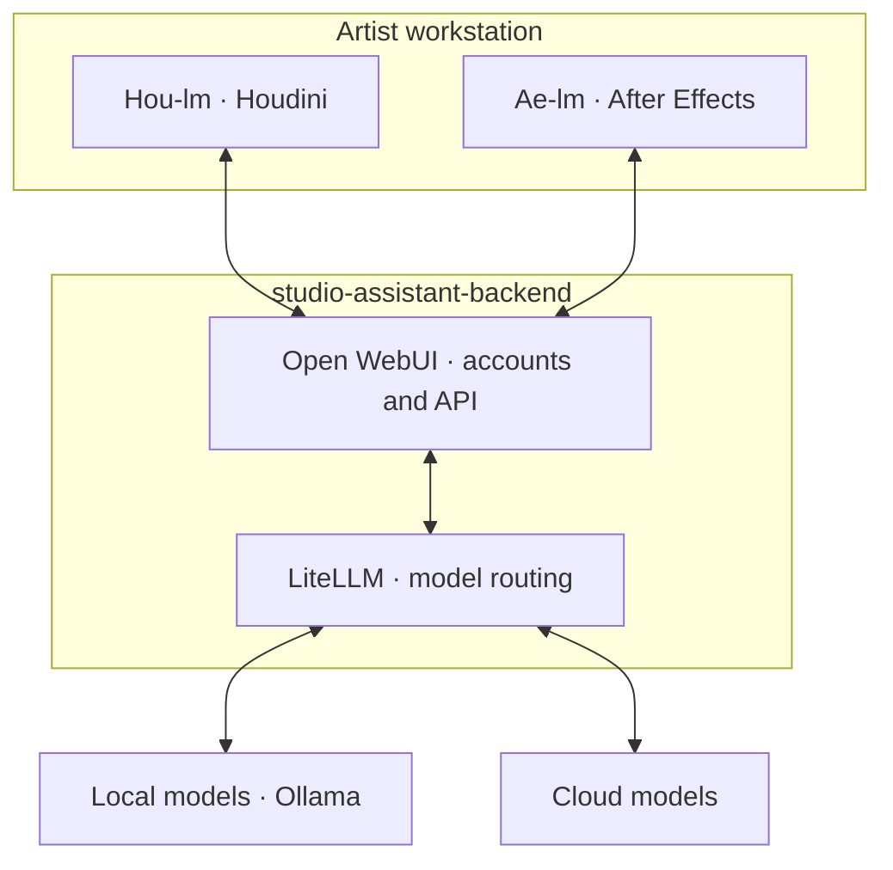

# Hou-lm

**Houdini client for [studio-assistant-backend](https://github.com/Byter3/studio-assistant-backend).** [Backend setup](https://github.com/Byter3/studio-assistant-backend/blob/main/docs/server-setup.md) · [After Effects client](https://github.com/Byter3/Ae-lm)

Conversational scene inspection, Python/HOM editing and reference-driven viewport feedback. **Windows · Houdini 20.5.445 · Python 3.11 / PySide2.**

## Shared backend

Clients send context, images and tool results through the service. Commands execute locally in Houdini or AE. An existing compatible Open WebUI service works too.

## Install

1. Extract the [plug-in ZIP](https://github.com/Byter3/Hou-lm/releases/download/v0.1.0/Hou-lm-0.1.0-houdini20.5.zip) into `$HOUDINI_USER_PREF_DIR/packages`: `hou-lm.json` beside `hou-lm/`.
2. Restart Houdini; open **+ → New Pane Tab Type → Hou-lm Assistant**.
3. In **Connections**, supply the Open WebUI base URL and user API key; select a tool-capable model.

The published v0.1.0 ZIP predates image features. [Build current source](CONTRIBUTING.md#build-the-houdini-plug-in) for those. No additional Python dependencies.

## Use

**Ctrl+Enter** sends. Drag nodes or use `@`. **Auto-run** skips command review; expand receipts for exact source/results. **Attach** adds image references; **Viewport access** enables native current-frame capture, which may cook. Use a vision-capable model for images.

History saves to `.houlm/<HIP>.json` with adjacent `.json.assets`; Save As carries it forward.

> Inspect /obj and report its immediate children. Do not modify anything or force a cook.

[Install/update](docs/package-install.md) · [Controls](docs/houdini-panel-quickstart.md) · [Visual workflow](docs/visual-reference.md) · [Troubleshooting](docs/tool-stream-troubleshooting.md) · [Development](CONTRIBUTING.md) · [Security](SECURITY.md) · [MIT](LICENSE)
